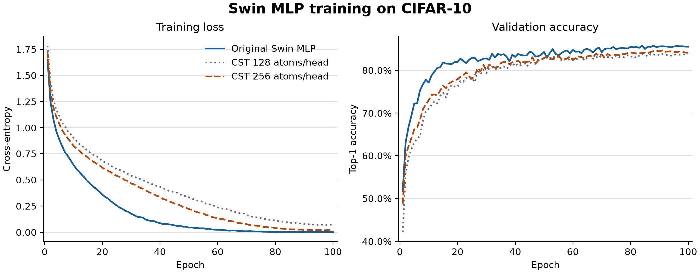

# CIFAR-10向け CST Swin MLP

[English](README.md) | 日本語

CIFAR-10で一から学習した小型のSwin MLPです。窓内でトークンを混ぜる各ヘッドの線形層に
`CSTLinear` を使います。最終チェックポイント3種類をSafetensorsとして
[Hugging Face](https://huggingface.co/takumiecd/cst-swin-mlp-cifar10)で配布しています。

## 推論

Python 3.11の環境を用意し、CIFAR-10の10クラスにあたる画像を指定します。初回に重みを
ダウンロードして、既定ではCPUで推論します。

```bash
git clone https://github.com/takumiecd/cst-swin-mlp-cifar10.git
cd cst-swin-mlp-cifar10
python -m pip install -r requirements.txt
python infer.py /path/to/image.jpg --variant cst-256
```

`--variant` で `baseline`、`cst-128`、`cst-256` を選べます。CUDAを使う場合は
`--device cuda`、ローカルの重みを読み込む場合は `--weights /path/to/file.safetensors`
を指定します。

## 結果

全モデルでseed 17を使い、第100エポックのチェックポイントを比較しました。

| モデル | 公式テストtop-1 | 検証top-1 | 窓内重みのパラメータ数 |
| --- | ---: | ---: | ---: |
| 元のSwin MLP | 85.62% | 85.50% | 49,152 |
| CST、128 Atom/ヘッド | 83.28% | 83.68% | 9,216 |
| CST、256 Atom/ヘッド | 83.75% | 84.08% | 18,432 |

CST-256の窓内重みのパラメータ数は元モデルの37.5%です。両CST版のAtom初期学習率は
0.0048でした。公式テスト10,000枚、学習45,000枚と検証5,000枚の条件で計測しました。
CIFAR-10の単一構成・単一seedの結果です。



[結果JSON](results/summary.json) · [エポックごとの測定値](results/history.csv)

## 学習の再現

2×2入力パッチ、初期幅256、8×8トークン窓、2ステージ各2ブロックの構成です。
RTX 4090を1枚使い、PyTorch 2.6.0+cu126、Torchvision 0.21.0+cu126、TF32無効のFP32で
学習しました。通常パラメータにAdamW、Atom座標にCSTAdamWを使い、両群にコサイン減衰を
適用しました。実行ごとに新規の出力先を指定します。

```bash
export OMP_NUM_THREADS=2 MKL_NUM_THREADS=2
common=(--data data/cifar10 --download --embed-dim 256 --window-size 8 \
  --epochs 100 --batch-size 128 --seed 17 --workers 2 --lr 0.001)

python train.py "${common[@]}" --variant baseline --output output/cst-256/baseline
python train.py "${common[@]}" --variant cst --atoms 256 --atom-lr 0.0048 \
  --output output/cst-256/cst
python train.py "${common[@]}" --variant cst --atoms 128 --atom-lr 0.0048 \
  --output output/cst-128/cst

python evaluate.py --run output/cst-256 --data data/cifar10 --output output/cst-256/test.json
python export_weights.py --variant cst-256 --checkpoint output/cst-256/cst/checkpoint.pt \
  --output output/cst-256.safetensors
```

学習曲線の比較図を作る場合は、Matplotlibをインストールしてスクリプトを実行します。

```bash
python -m pip install matplotlib
python plot.py --run output/cst-256 --reference-cst output/cst-128/cst/metrics.json \
  --output output/learning-curves.png
```

実験コードと配布重みのライセンスは[Apache-2.0](LICENSE)です。`third_party` に含めた
[MicrosoftのSwin MLP実装](https://github.com/microsoft/Swin-Transformer/blob/f82860bfb5225915aca09c3227159ee9e1df874d/models/swin_mlp.py)は
[MITライセンス](third_party/LICENSE)です。
