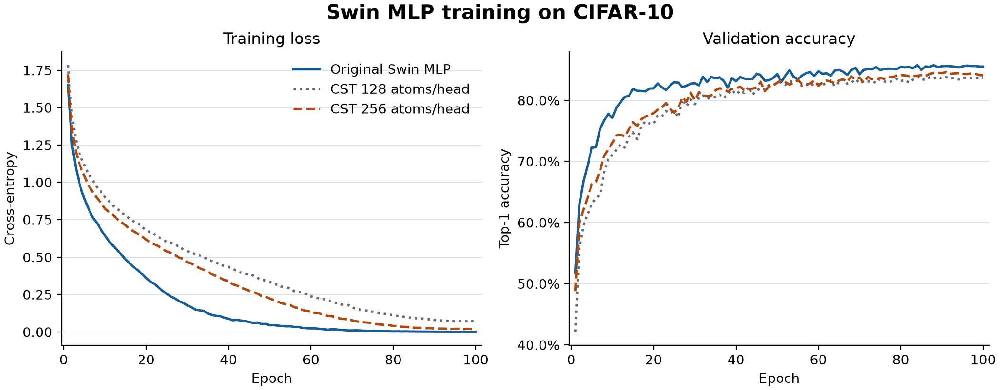

# CST Swin MLP for CIFAR-10

English | [日本語](README.ja.md)

A small Swin MLP trained from scratch on CIFAR-10, with a `CSTLinear` in each
window-mixing head. The [Hugging Face model repository](https://huggingface.co/takumiecd/cst-swin-mlp-cifar10)
hosts the three final checkpoints as Safetensors.

## Run inference

Clone this repository, create a Python 3.11 environment and use an RGB image
representative of one of the ten CIFAR-10 classes. The script downloads the
selected weights through `torchcst.hub.from_pretrained()` on first use.
CPU inference is the default.

```bash
git clone https://github.com/takumiecd/cst-swin-mlp-cifar10.git
cd cst-swin-mlp-cifar10
python -m pip install -r requirements.txt
python infer.py /path/to/image.jpg --variant cst-256
```

Choose `baseline`, `cst-128` or `cst-256`. Use `--device cuda` for a CUDA
environment or `--weights /path/to/file.safetensors` to load a local file.

## Results

CIFAR-10 top-1 accuracy at epoch 100, using seed 17 for all three models.

| Variant | Official test | Validation | Window weight parameters |
| --- | ---: | ---: | ---: |
| Original Swin MLP | 85.62% | 85.50% | 49,152 |
| CST, 128 atoms/head | 83.28% | 83.68% | 9,216 |
| CST, 256 atoms/head | 83.75% | 84.08% | 18,432 |

CST-256 used 37.5% of the original window weight parameter count. The two CST
models used an Atom initial learning rate of 0.0048. The official test split
has 10,000 images. The training split has 45,000 images and validation has 5,000
images. This release measures one CIFAR-10 configuration and one training seed.



[Results JSON](results/summary.json) · [Per-epoch measurements](results/history.csv)

## Reproduce the training

The model uses 2×2 input patches, first-stage width 256, 8×8 token windows and
two stages with two blocks each. Training used a single RTX 4090, PyTorch
2.6.0+cu126, Torchvision 0.21.0+cu126, FP32 with TF32 disabled, AdamW for
ordinary parameters and CSTAdamW for Atom coordinates. Both groups use cosine
decay. Pass a new output directory on each run.

```bash
export OMP_NUM_THREADS=2 MKL_NUM_THREADS=2
common=(--data data/cifar10 --download --embed-dim 256 --window-size 8 \
  --epochs 100 --batch-size 128 --seed 17 --workers 2 --lr 0.001)

python train.py "${common[@]}" --variant baseline --output output/cst-256/baseline
python train.py "${common[@]}" --variant cst --atoms 256 --atom-lr 0.0048 \
  --output output/cst-256/cst
python train.py "${common[@]}" --variant cst --atoms 128 --atom-lr 0.0048 \
  --output output/cst-128/cst

python evaluate.py --run output/cst-256 --data data/cifar10 --output output/cst-256/test.json
python export_weights.py --variant cst-256 --checkpoint output/cst-256/cst/checkpoint.pt \
  --output output/cst-256.safetensors
```

For the comparison figure, install Matplotlib and run the plotting script.

```bash
python -m pip install matplotlib
python plot.py --run output/cst-256 --reference-cst output/cst-128/cst/metrics.json \
  --output output/learning-curves.png
```

The experiment code and released weights use [Apache-2.0](LICENSE). The pinned
[Microsoft Swin MLP source](https://github.com/microsoft/Swin-Transformer/blob/f82860bfb5225915aca09c3227159ee9e1df874d/models/swin_mlp.py)
in `third_party` uses the [MIT license](third_party/LICENSE).
